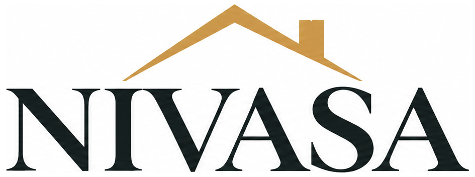
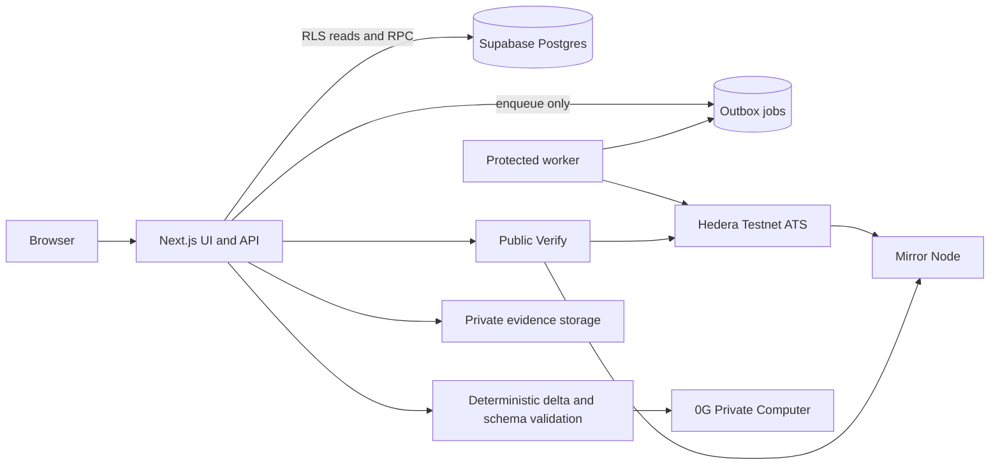

<p align="center">
  
</p>

<h1 align="center">Verifiable infrastructure for the property-asset lifecycle</h1>

<p align="center">
  Evidence review · Rights versioning · Controlled issuance · Settlement recovery · Public verification
</p>

<p align="center">
  
  
  
  
  
</p>

<p align="center"><strong>SIMULATED DEMO · NOT A REAL OFFERING</strong></p>

NIVASA explores a connected workflow for commercial-property evidence, investor rights, eligibility, controlled issuance, settlement recovery and post-issuance verification. The prototype uses one fictional Maharashtra commercial property, Hedera Testnet ATS and 0G Private Computer.

> [!CAUTION]
> NIVASA does not establish title, offer an investment, authenticate source documents, move real INR, promise returns, provide legal advice or represent a government-approved service. A hash proves byte integrity—not the authenticity or legal effect of a document. Testnet balances are not ownership.

## Explore

| | |
|---|---|
| **Architecture & security** | [Architecture](docs/architecture.md) · [Threat model](docs/threat-model.md) · [Limitations](docs/limitations.md) · [ATS gate](docs/ats-gate.md) |
| **Demo & verification** | [Eight-beat demo script](docs/demo-script.md) · [Adversarial report](docs/adversarial-report.md) |
| **Project specification** | [PRD](docs/PRD.md) · [UI](docs/UI.md) · [Architecture V4](docs/NIVASA%20%E2%80%94%20Architecture%20V4.md) |
| **Setup** | [Environment variable names](#environment-variable-names) · [Local setup](#run-locally) · [Test commands](#checks-and-current-status) |

## What NIVASA demonstrates

- Evidence uploads, server-side file hashes, versioned manifests and independent verifier review.
- Rights-document hashing, offering proposals and a gated activation checklist.
- Permissioned wallet eligibility and supply-limited Hedera ATS operations.
- Simulated-payment settlement using an outbox, retries and reconciliation.
- Evidence-drift pause and independently reviewed resume flows.
- Public technical verification and 0G explanations grounded in deterministic snapshot deltas.

### Boundaries and legal limits

DELTA is **proposed, not enacted**. Tokenization is not land ownership. An SPV does not solve securities regulation. Any real deployment requires Indian legal and regulatory analysis, an appropriately authorized issuer, independent property diligence, and operational and security review. Demo figures are simulated and are not investment advice.

### Prior-art method and permitted claim

The project plan records a keyword search of the ETHGlobal showcase dataset (18,693 projects across 69 events; snapshot dated 25 September 2026), plus targeted showcase-page searches. Keyword and showcase coverage is incomplete, vocabulary differs, and the snapshot is dated.

> “In a keyword search of a 25 September 2026 snapshot of the ETHGlobal showcase, we did not find a project combining property evidence review, evidence-gated ATS issuance, automatic pause on evidence change, recoverable settlement and a public verification page.”

This is a bounded search result, not a claim of priority or uniqueness.

## How it fits together



### Roles and workflow

| Role | Main workflow | Key restriction |
|---|---|---|
| **Issuer** | Create a property draft, upload evidence, submit a manifest, propose an offering and rights, upload revised evidence | Cannot approve own property, manifest or offering |
| **Verifier** | Independently review evidence and eligibility; approve post-drift resume | Must be independent under database-enforced separation of duties |
| **Investor** | Bind a wallet, request eligibility and place a simulated order | Cannot read another investor’s private records |
| **Admin** | Manage trusted roles and demo controls | Privileged mutations are authorized and audited |

The application derives roles from an operator-provisioned Supabase account. A navigation role selector is not authentication. The issuer workspace includes an offering proposal form; offering rights, approval and activation checks continue on the offering detail page. The app does not automatically activate a new proposal.

## Implementation status

| Workstream | Status | Scope note |
|---|---|---|
| **D1 — Evidence-gated issuance** | **BUILT** | Proposal and activation checks are implemented; live readiness depends on configured chain asset and approvals. |
| **D2 — Evidence drift pause/resume** | **BUILT** | Detects changes NIVASA observes; does not monitor unreported external land-record changes. |
| **D3 — Public Verify** | **BUILT** | Provides technical integrity checks, not legal title verification. |
| **D4 — Settlement recovery** | **BUILT** | Outbox retry and reconciliation workflow. |
| **D5 — 0G change intelligence** | **BUILT** | Deterministic code calculates changes; model output cannot authorize actions or mutate the chain. Current successful request ID must be independently resolved before claiming a live demo. |
| **D6 — Maharashtra checklist** | **BUILT** | Completeness score is not statutory title clearance. Benchmark snapshots are **DESIGNED-NOT-BUILT** (Tier C). |

## Hedera ATS and 0G evidence

The repository references Hedera Testnet ATS asset `0.0.11330441` (EVM `0x52ed835e649a4b045a21bc5e240623d8a77f73ef`). `package-lock.json` resolves `@hashgraph/asset-tokenization-sdk` **8.0.0** and Hedera SDK **2.81.0**. Adapter mode is **`sdk`**. The upstream ATS source commit is not separately pinned here.

The following are previously recorded M1 gate references, **not a fresh M15 demo run**. Re-resolve every reference before submission.

| Evidence | Testnet reference | HashScan |
|---|---|---|
| ATS asset | `0.0.11330441` | [Asset contract](https://hashscan.io/testnet/contract/0.0.11330441) |
| Asset deployment | `0.0.11330244@1793915035.423095166` | [Deployment transaction](https://hashscan.io/testnet/transaction/0.0.11330244-1793915035-423095166) |
| Initial issue | `0.0.11324646@1793915421.221170832` | [Issue transaction](https://hashscan.io/testnet/transaction/0.0.11324646-1793915421-221170832) |
| Rights/manifest document anchor | `0.0.11330244@1793915456.826762270` | [Document transaction](https://hashscan.io/testnet/transaction/0.0.11330244-1793915456-826762270) |
| Pause | `0.0.11330245@1793915521.144401076` | [Pause transaction](https://hashscan.io/testnet/transaction/0.0.11330245-1793915521-144401076) |
| Rejected ineligible transfer | `0.0.11330246@1793915559.481948622` | [Rejected transfer record](https://hashscan.io/testnet/transaction/0.0.11330246-1793915559-481948622) |

No current 0G request ID is asserted here: the recorded M15 adversarial run did not find the two property snapshots needed for the live inference case. Record only an ID returned by a fresh successful request and independently verify it with the provider. No 0G Storage root is claimed.

## Run locally

**Prerequisites:** Node.js `22.18.0`; npm `10.9.3`.

```powershell
npm ci
Copy-Item .env.example .env.local  # add local values; never commit secrets
npm run env:check
npm run dev
```

Apply SQL migrations from `supabase/migrations/` to the connected Supabase project, including the private `evidence-vault` bucket migration. Load `supabase/seed.sql` as appropriate. Configure Supabase Auth and provision test accounts before API integration tests.

Evidence files are stored in the private persistent storage bucket; serverless function-local disk is not used. RLS should be exercised through user-scoped clients. Service-role access is server-only. Database constraints enforce separation of duties and audit immutability. Chain writes are queued through the outbox worker; settlement completion requires reconciliation.

### Checks and current status

```bash
npm run typecheck
npm run lint
npm run lint:tokens
npm run security:secrets
npm test
npm run adversarial
npm run ats:gate
npm run restriction:proof
```

Live integration commands require authorized database, provider and testnet credentials and may change testnet state. The checked-in [adversarial report](docs/adversarial-report.md) is **not green**. The latest full test run recorded **17 files: 92 passed, 18 failed, 86 skipped**. Reported issues include missing user profiles, unavailable Supabase DNS, missing 0G snapshots, a rights fixture mismatch and a Hedera test timeout. The production build did not complete in that environment: Google Fonts DNS failed and Next.js hit `EPERM` writing route output. Prior milestone summaries do not replace a successful current run.

### Environment variable names

See [.env.example](.env.example). Names only; values are intentionally omitted.

<details>
<summary>Application and Supabase</summary>

- App: `NEXT_PUBLIC_APP_URL`, `APP_ENV`, `CRON_SECRET`, `DEMO_PAYMENTS`, `DEMO_FAULTS`, `DEMO_EVENTS`, `PARCEL_HMAC_SECRET`, `ISSUER_DAILY_UNIT_CAP`.
- Database/Supabase: `DATABASE_URL`, `DIRECT_URL`, `POSTGRES_URL`, `NEXT_PUBLIC_SUPABASE_URL`, `NEXT_PUBLIC_SUPABASE_ANON_KEY`, `NEXT_PUBLIC_SUPABASE_PUBLISHABLE_KEY`, `SUPABASE_SERVICE_ROLE_KEY`.

</details>

<details>
<summary>Hedera and ATS</summary>

- Hedera: `HEDERA_NETWORK`, `HEDERA_JSON_RPC_URL`, `HEDERA_MIRROR_NODE_URL`, `HEDERA_DEPLOYER_ACCOUNT_ID`, `HEDERA_DEPLOYER_PRIVATE_KEY`, `HEDERA_ISSUER_AGENT_ACCOUNT_ID`, `HEDERA_ISSUER_AGENT_PRIVATE_KEY`, `HEDERA_COMPLIANCE_ACCOUNT_ID`, `HEDERA_COMPLIANCE_PRIVATE_KEY`, `HEDERA_PAUSER_ACCOUNT_ID`, `HEDERA_PAUSER_PRIVATE_KEY`, `HEDERA_INVESTOR_ELIGIBLE_ACCOUNT_ID`, `HEDERA_INVESTOR_ELIGIBLE_PRIVATE_KEY`, `HEDERA_INVESTOR_INELIGIBLE_ACCOUNT_ID`, `HEDERA_INVESTOR_INELIGIBLE_PRIVATE_KEY`, `HCS_AUDIT_TOPIC_ID`.
- ATS: `ATS_ADAPTER_MODE`, `ATS_ASSET_REF`, `ATS_FACTORY_ADDRESS`, `ATS_RESOLVER_ADDRESS`, `ATS_ASSET_CONTRACT_ID`, `ATS_ASSET_ADDRESS`, `HEDERA_ATS_FACTORY_ADDRESS`, `HEDERA_ATS_RESOLVER_ADDRESS`.

</details>

<details>
<summary>0G</summary>

- `OG_API_KEY`, `OG_BASE_URL`, `OG_MODEL`, `OG_STORAGE_PRIVATE_KEY`, `OG_STORAGE_RPC`, `OG_STORAGE_INDEXER`.

Privileged credentials must never use `NEXT_PUBLIC_*` names or reach client code.

</details>

## Limitations and production readiness

See [docs/limitations.md](docs/limitations.md). Drift checks notice evidence changes uploaded to NIVASA, hash mismatches and configured expiry conditions. They cannot observe an external registry change that is never supplied to NIVASA. Evidence review is not title clearance. There is no real payment rail and the prototype has no independent production security audit.

Production requires written Indian legal analysis of the instrument, issuer and DELTA's operative status; central/state law and securities characterization; company/trust/SPV advice; independent title, encumbrance, litigation and valuation diligence; RERA analysis where applicable; KYC/AML/sanctions; DPDP Act privacy assessment with a deletion path that coexists with audit retention; tax/stamp duty/registration/accounting analysis; regulated payment and custody providers; investor disclosures and grievance handling; smart-contract/application security audits and independent penetration testing; multisig key custody, rotation and recovery; controls for distributions, redemptions, defaults, disputes and secondary transfers; monitoring; and append-only audit storage outside the application database. A prototype establishes neither legal feasibility nor regulatory permission. (ARCH §27)

## Demo assets

- Demo app: **not confirmed for this handoff**.
- Hedera video: **not recorded/attached**.
- Separate 0G video: **not recorded/attached**.
- Clean-browser acceptance and current live prize/rule review: **human action pending**.
- Follow [the eight-beat demo script](docs/demo-script.md); run the real flow first and use only transaction/request links copied from real records.

## AI-use disclosure

AI tools assisted with code, tests, reports and documentation. Human review and live verification remain necessary. The application uses 0G Private Computer for validated, evidence-grounded explanations; deterministic code computes numeric changes, and model output cannot authorize actions or mutate the chain.

## License

No license file or license grant is present. All rights are reserved by default; obtain the project owner’s license decision before reuse or redistribution.
