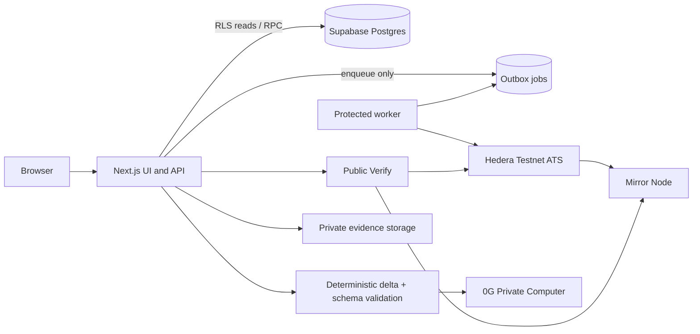

# NIVASA — RWA lifecycle infrastructure prototype

> **SIMULATED DEMO · NOT A REAL OFFERING**

NIVASA explores a real-world-asset lifecycle gap: commercial property evidence, investor rights, eligibility, controlled issuance, settlement recovery and post-issuance verification often sit in disconnected processes. It demonstrates a connected workflow for one fictional property using Hedera Testnet ATS and 0G Private Computer.

## What it does and does not do

NIVASA demonstrates evidence manifests and review, rights hashing, gated ATS issuance, wallet restrictions, simulated-payment settlement with outbox recovery, evidence-drift pause/resume, public technical verification, and 0G explanations grounded in deterministic snapshot deltas.

It does not establish title, authenticate source documents, offer an investment, move real INR, promise returns, provide legal advice, or represent a government-approved service. A hash proves byte integrity, not authenticity. Testnet balances are not ownership.

**Legal and regulatory limits:** DELTA is proposed, not enacted. Tokenization is not land ownership. An SPV does not solve securities regulation. Any real deployment needs Indian legal and regulatory analysis, a properly authorized issuer, independent property diligence, and operational/security review. Demo figures are simulated and not investment advice.

## Prior-art method and permitted claim

The project plan records a keyword search of the ETHGlobal showcase dataset (18,693 projects/69 events, snapshot 25 September 2026) plus targeted showcase-page searches. Keyword and showcase coverage is incomplete, vocabulary differs, and the snapshot is dated. **Permitted claim:** “In a keyword search of a 25 September 2026 snapshot of the ETHGlobal showcase, we did not find a project combining property evidence review, evidence-gated ATS issuance, automatic pause on evidence change, recoverable settlement and a public verification page.” This is a bounded search result, not a claim of priority or uniqueness.

## Architecture



More detail: [architecture](docs/architecture.md), [threat model](docs/threat-model.md), [limitations](docs/limitations.md), [ATS gate](docs/ats-gate.md).

### Roles and workflow

- **Issuer:** submits property evidence, rights and revised evidence; cannot approve their own submissions.
- **Verifier:** reviews evidence and eligibility, and independently approves post-drift resume.
- **Investor:** binds a wallet, requests eligibility and places a simulated order; cannot read another investor’s private records.
- **Admin:** manages trusted roles and demo controls; mutations are authorized and audited.

The public header now links to the issuer workspace. Issuer, verifier, investor and admin access requires an operator-provisioned Supabase account; the application derives roles from that account and does not treat the navigation selector as authentication. The issuer workspace can create a property draft, upload evidence, and submit a manifest for independent review. New offering proposals currently require the authenticated `/api/offerings` endpoint after a property has an approved manifest; an issuer-facing proposal form is not included.

The eight-beat demo is documented in [docs/demo-script.md](docs/demo-script.md). Complete a real run before recording and use only transaction/request links copied from actual records.

### Differentiators

- D1 evidence-gated issuance — **BUILT**.
- D2 evidence-drift pause/resume — **BUILT**; drift detection covers changes observed within NIVASA, not unreported external land-record changes.
- D3 public Verify — **BUILT**.
- D4 settlement recovery — **BUILT**.
- D5 0G change intelligence — **BUILT**; a current successful request ID must be recorded and independently resolved for this submission.
- D6 Maharashtra checklist and completeness score — **BUILT**; benchmark snapshots are **DESIGNED-NOT-BUILT** (Tier C).

## Hedera ATS and 0G evidence

The repository documents Hedera Testnet asset `0.0.11330441` (EVM `0x52ed835e649a4b045a21bc5e240623d8a77f73ef`), ATS SDK resolved by `package-lock.json` to `@hashgraph/asset-tokenization-sdk` **8.0.0**, Hedera SDK **2.81.0**, and adapter mode **`sdk`**. The ATS upstream source commit is not separately pinned in this repository.

Previously recorded M1 gate references (not a fresh M15 demo run; re-resolve before submission):

| Evidence | Testnet reference | HashScan |
|---|---|---|
| ATS asset | `0.0.11330441` | [Asset contract](https://hashscan.io/testnet/contract/0.0.11330441) |
| Asset deployment | `0.0.11330244@1793915035.423095166` | [Deployment transaction](https://hashscan.io/testnet/transaction/0.0.11330244-1793915035-423095166) |
| Initial issue | `0.0.11324646@1793915421.221170832` | [Issue transaction](https://hashscan.io/testnet/transaction/0.0.11324646-1793915421-221170832) |
| Rights/manifest document anchor | `0.0.11330244@1793915456.826762270` | [Document transaction](https://hashscan.io/testnet/transaction/0.0.11330244-1793915456-826762270) |
| Pause | `0.0.11330245@1793915521.144401076` | [Pause transaction](https://hashscan.io/testnet/transaction/0.0.11330245-1793915521-144401076) |
| Rejected ineligible transfer | `0.0.11330246@1793915559.481948622` | [Rejected transfer record](https://hashscan.io/testnet/transaction/0.0.11330246-1793915559-481948622) |

No current 0G request ID is asserted by this README: the M15 adversarial run could not find the required two property snapshots for the live inference case. Record only a real ID returned by a fresh successful call and verify it with the provider. No 0G Storage root is claimed.

## Database and security

Apply the SQL migrations in `supabase/migrations/` to the connected Supabase project, including the private `evidence-vault` bucket migration, then load `supabase/seed.sql` as appropriate. Evidence binaries are stored in that private persistent bucket; serverless function-local disk is not used. Configure Supabase auth and test accounts before API integration tests. RLS must be exercised through user-scoped clients; service-role access is server-only. Database constraints enforce separation of duties and audit immutability. Chain writes go through the outbox worker; settlement completion requires reconciliation.

The M15 adversarial run currently fails; see [docs/adversarial-report.md](docs/adversarial-report.md). Observed missing profile setup, skipped integration suites, and missing 0G snapshots prevent claiming M15 acceptance. Do not treat prior milestone summaries as a substitute for this run.

## Local setup

Prerequisites recorded by the project: Node.js `22.18.0`, npm `10.9.3`.

```bash
npm ci
Copy-Item .env.example .env.local  # populate locally; never commit values
npm run env:check
npm run dev
```

Commands: `npm run typecheck`, `npm run lint`, `npm run lint:tokens`, `npm run security:secrets`, `npm test`, `npm run adversarial`, `npm run ats:gate`, and `npm run restriction:proof`. Live integration commands require authorized testnet/database/provider credentials and can affect testnet state. The latest full test run reported **17 files: 92 passed, 18 failed, 86 skipped**. Failures include missing user profiles, unavailable Supabase DNS, absent 0G snapshots, a rights fixture mismatch, and a Hedera test timeout. The production build did not complete in this environment: Google Fonts DNS failed and Next.js hit `EPERM` creating `.next` route output. The checked-in adversarial report is not green.

### Environment variable names

See [.env.example](.env.example). Names only:

- App: `NEXT_PUBLIC_APP_URL`, `APP_ENV`, `CRON_SECRET`, `DEMO_PAYMENTS`, `DEMO_FAULTS`, `DEMO_EVENTS`, `PARCEL_HMAC_SECRET`, `ISSUER_DAILY_UNIT_CAP`.
- Database/Supabase: `DATABASE_URL`, `DIRECT_URL`, `POSTGRES_URL`, `NEXT_PUBLIC_SUPABASE_URL`, `NEXT_PUBLIC_SUPABASE_ANON_KEY`, `NEXT_PUBLIC_SUPABASE_PUBLISHABLE_KEY`, `SUPABASE_SERVICE_ROLE_KEY`.
- Hedera: `HEDERA_NETWORK`, `HEDERA_JSON_RPC_URL`, `HEDERA_MIRROR_NODE_URL`, `HEDERA_DEPLOYER_ACCOUNT_ID`, `HEDERA_DEPLOYER_PRIVATE_KEY`, `HEDERA_ISSUER_AGENT_ACCOUNT_ID`, `HEDERA_ISSUER_AGENT_PRIVATE_KEY`, `HEDERA_COMPLIANCE_ACCOUNT_ID`, `HEDERA_COMPLIANCE_PRIVATE_KEY`, `HEDERA_PAUSER_ACCOUNT_ID`, `HEDERA_PAUSER_PRIVATE_KEY`, `HEDERA_INVESTOR_ELIGIBLE_ACCOUNT_ID`, `HEDERA_INVESTOR_ELIGIBLE_PRIVATE_KEY`, `HEDERA_INVESTOR_INELIGIBLE_ACCOUNT_ID`, `HEDERA_INVESTOR_INELIGIBLE_PRIVATE_KEY`, `HCS_AUDIT_TOPIC_ID`.
- ATS: `ATS_ADAPTER_MODE`, `ATS_ASSET_REF`, `ATS_FACTORY_ADDRESS`, `ATS_RESOLVER_ADDRESS`, `ATS_ASSET_CONTRACT_ID`, `ATS_ASSET_ADDRESS`, `HEDERA_ATS_FACTORY_ADDRESS`, `HEDERA_ATS_RESOLVER_ADDRESS`.
- 0G: `OG_API_KEY`, `OG_BASE_URL`, `OG_MODEL`, `OG_STORAGE_PRIVATE_KEY`, `OG_STORAGE_RPC`, `OG_STORAGE_INDEXER`.

Privileged credentials must never use `NEXT_PUBLIC_*` names or reach client code. Values are intentionally omitted.

## Limitations and production requirements

See [docs/limitations.md](docs/limitations.md). Drift checks notice changes uploaded to NIVASA, hash mismatches and configured expiry conditions; they cannot observe an external registry change that is never supplied to NIVASA. Evidence review is not title clearance. The prototype has no real payment rail and no independent production security audit.

Production requires written Indian legal analysis of the instrument/issuer and DELTA's operative status; central/state law and securities characterization; company/trust/SPV advice; independent title, encumbrance, litigation and valuation diligence; RERA analysis where applicable; KYC/AML/sanctions; DPDP Act privacy assessment with a deletion path that coexists with audit retention; tax/stamp duty/registration/accounting analysis; regulated payment and custody providers; investor disclosures and grievance handling; smart-contract/application security audits and independent penetration testing; multisig key custody, rotation and recovery; controls for distributions, redemptions, defaults, disputes and secondary transfers; monitoring; and append-only audit storage outside the application database. A prototype does not establish legal feasibility or regulatory permission. (ARCH §27)

## Demo assets and videos

- Demo app: **not confirmed for this handoff**.
- Hedera video: **not recorded/attached**.
- Separate 0G video: **not recorded/attached**.
- Clean-browser acceptance and current live prize/rule review: **human action pending**.

## AI-use disclosure

AI tools assisted with code, test/report authoring and documentation. Human review and live verification remain necessary. 0G Private Computer is used by the application for validated, evidence-grounded explanations; deterministic code computes numeric changes, and model output cannot authorize actions or mutate the chain.

## License

No license file or license grant is present in this repository. All rights are reserved by default; obtain the project owner’s license decision before reuse or redistribution.
