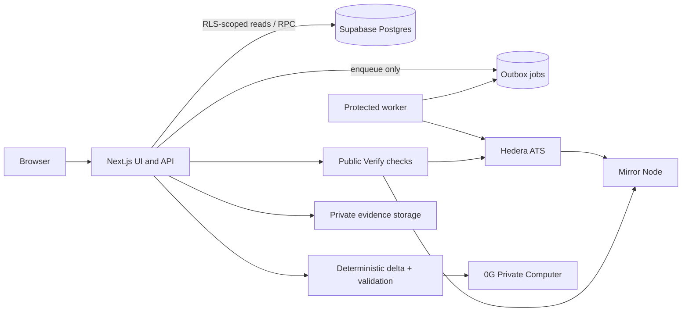

# Architecture

NIVASA uses Next.js 15 App Router and TypeScript, Supabase PostgreSQL with RLS for workflow state, private storage for evidence, Hedera Testnet ATS for restricted asset state, and 0G Private Computer for validated explanations of deterministic snapshot changes.

The ATS is authoritative for supply, eligibility controls, pause state and balances. Supabase holds user/workflow records and private evidence. Chain effects are queued to the protected worker and reconciled before orders become complete. Public Verify returns PASS, FAIL or UNAVAILABLE; hashes demonstrate integrity, not authenticity or title. Deterministic code calculates figures; 0G can explain validated supplied deltas but cannot authorize actions.

Roles are issuer, verifier, investor and admin. RLS and database constraints enforce access boundaries and separation of duties. See [threat-model.md](threat-model.md), [limitations.md](limitations.md), [demo-script.md](demo-script.md), and [ats-gate.md](ats-gate.md).

## Differentiator status

- D1 evidence-gated issuance — **BUILT**.
- D2 evidence drift pause/resume — **BUILT**.
- D3 public Verify — **BUILT**.
- D4 settlement recovery — **BUILT**.
- D5 change intelligence — **BUILT**; a live provider request must be recorded and rechecked for this submission.
- D6 Maharashtra evidence checklist/completeness — **BUILT**; benchmark snapshots are **DESIGNED-NOT-BUILT** (Tier C).
